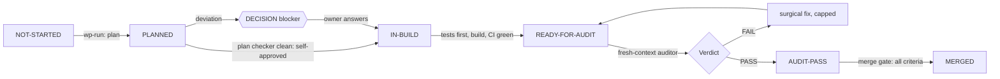

# Work package workflow (operating model v2)

Five roles take part:
- the **owner** sets the bar (specs, process, kit) and provides capabilities;
- the **coordinator** is a Claude Code Project conversation that starts threads;
- the **builder** is one thread per WP, running `/wp-run`;
- the **auditor** is a fresh-context subagent that never sees the builder's conversation;
- the **implementer** is Gemini, reached through work orders.

## Steps

| Step | Who | What | Output |
| --- | --- | --- | --- |
| 1 | Owner | Commit the phase specs (with the dependency graph) to `main` | Specs on `main` |
| 2 | Coordinator | Start a thread per ready WP: `/wp-run WP-x.y` | One branch per WP |
| 3 | Builder | Plan, plan check, self-approve or raise DECISIONs | `PLAN.md` |
| 4 | Builder | Acceptance tests and break recipes first; build, outsourcing bulk code | Code, tests, `EVIDENCE.md`, pull request |
| 5 | Auditor | Tiered audit under protocol v3 | `AUDIT.md` |
| 6 | Builder | Scoped fixes and re-audits until PASS, within caps | `FIXES.md` |
| 7 | Builder | Merge gate | Merged; the status fragment on `main` reads as MERGED |
| 8 | Owner | Answer owner-queue items; run batched post-merge checks weekly | Reports, decisions |

## Rules
- One WP per thread and per branch. A thread ends after its WP's closeout.
- Specs, process and kit live only on `main`, written by the owner. Plans conforming to the spec need no approval file.
- A WP is **done** when every requirement has tests and evidence, the audit verdict is PASS for the merged head, CI is green, blocking owner-run checks have PASS reports, no blocker for the WP is open, and the merge gate merged it.
- Status values: `NOT-STARTED`, `PLANNED`, `IN-BUILD`, `READY-FOR-AUDIT`, `AUDIT-FAIL`, `AUDIT-PASS`, `MERGE-READY` (interim, before the gate exists), `MERGED`, `OWNER-RUN`, `BLOCKED`. On `main`, a status fragment that says AUDIT-PASS or MERGE-READY is rendered as MERGED, because fragments reach `main` only through the merge.
- Interim rules until WP-1.0 installs its tooling: `docs/process/AUTONOMY.md`, last section.
