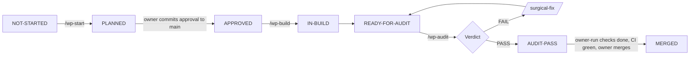

# Work package workflow

Three roles take part. The **owner** decides and merges. The **builder** is the main Claude Code session. The **auditor** is the `wp-auditor` subagent, started by `/wp-audit`, which never sees the builder's conversation.

## Steps

| Step | Who | Action | Output |
| --- | --- | --- | --- |
| 1 | Owner | New cloud session from `main`; `/effort high`; `/wp-start WP-x.y` | `docs/progress/WP-x.y/PLAN.md` on the session branch |
| 2 | Owner | Read the plan; answer questions; commit `docs/approvals/WP-x.y.md` to `main` | Approval on `main` |
| 3 | Owner | Session on the plan's branch; `/wp-build WP-x.y` | Code, tests, `EVIDENCE.md`, pull request |
| 4 | Owner | `/wp-audit WP-x.y` in the same or a new session | `AUDIT.md` with verdict |
| 5 | Owner | If FAIL: `/surgical-fix <finding IDs>`, then audit again | `FIXES.md`, new `AUDIT.md` |
| 6 | Owner | Run owner-run checks (Colab, Oracle) and commit their reports | Reports under `docs/environment/` or the WP folder |
| 7 | Owner | Merge the pull request when AUDIT is PASS, CI is green and no blocker is open | STATUS set to MERGED |

## Rules

- One WP per session. Do not mix WPs on one branch.
- Approvals live only on `main`, written by the owner. The builder picks them up by merging `origin/main`.
- A WP is **done** only when: every requirement has tests and evidence, the audit verdict is PASS, CI is green, owner-run checks are committed, no blocker for the WP is open, and the owner has merged it.
- Status values: `NOT-STARTED`, `PLANNED`, `APPROVED`, `IN-BUILD`, `READY-FOR-AUDIT`, `AUDIT-FAIL`, `AUDIT-PASS`, `MERGED`, `OWNER-RUN`, `BLOCKED`.
